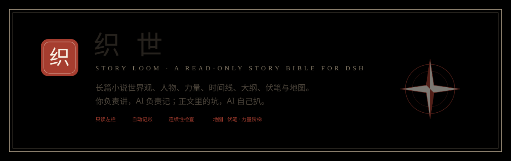

# dsh-story-loom · 织世

<p align="center"></p>

一个**只读**的长篇小说故事档案，放在 DSH 左侧栏，和学习插件一样的入口。你负责在对话里讲，AI 负责把设定、人物、伏笔、时间线、大纲、地图和正文账本写进去；你随时点左侧「织世」翻阅。

它不是编辑器。面板不提供新增、修改、删除，避免两边打架；要改什么，直接对 AI 说。

数据落在工作区的 `story-loom/`，纯 JSON + 图片，随时可以备份、迁移。

## 隐私

- 插件只读写本机工作区的 `story-loom/`，**不收集、不上传任何作品数据**。
- 没有账号系统、云端同步或遥测；Host 只注册本地 `/story-loom` 路由。
- 这个仓库**不包含任何作者的小说数据**。内置的「雾港夜航」只是演示用示例世界，不是任何作者的作品。
- 如果你把 `story-loom/` 放进 Git 仓库，请先把 `story-loom/`、`exports/` 加入 `.gitignore`，避免把作品推到公开仓库。
- 面板是只读的；这里只是创作辅助工具，不是作品发布渠道。

---

## 它解决什么

- **随时查阅**：左侧「织世」入口打开完整档案，不用翻聊天记录。
- **AI 记账**：你在对话里说设定，AI 拆成人物、势力、地点、力量、时间线等条目写进去。
- **自动扒坑**：你发正文，AI 从文章里找伏笔、异常、秘密、承诺、结尾钩子，自动登记，不用你手填。
- **不前后矛盾**：连续性检查会抓断链、越阶、死者复现、伏笔逾期、时间线错位。
- **不漏坑**：伏笔有账本：待埋 / 已埋 / 推进中 / 待回收 / 已回收。
- **战力不崩**：力量阶梯 + 能力最低境界 + 人物当前境界，越阶报警。
- **时间不崩**：时间线用数字排序，事件可关联章节。
- **地图可查**：上传地图，地点钉在上面，点图钉回到地点档案。
- **AI 有上下文**：给某一章生成写作上下文，包含正典、人物状态、前情、伏笔、时间线、文风约束、连续性警告。

## 位置

左侧栏的 **织世** 图标（和学习插件同一列）。点开后是中央主面板，不在右侧栏。

- 左栏：故事目录（总览、人物、地理、力量、剧情、资料、图鉴）
- 中间：当前板块的卡片 / 清单 / 时间线 / 大纲树 / 伏笔看板 / 地图
- 右侧：只读条目详情
- 顶部：搜索、切换世界、刷新、连续性

数据由 AI 写入；面板每 8 秒自动同步，也可以点右上角刷新。

## 安装

```bash
# 从本地目录安装
dsh plugin --profile desktop add link:/absolute/path/to/dsh-story-loom

# 从 GitHub 安装
dsh plugin --profile desktop add github:v8srm7p5tj-lgtm/dsh-story-loom
```

安装后在插件页启用这个组合包。本插件的 `cordis.patch.yml` 会自动插入 Host 行；不需要手动改 profile。

如果你是从源码目录安装、且 profile 里已经手动插过 `story-loom` 行，请删掉手动那一行，避免重复。

## 目录

```
dsh-story-loom/          插件本体
  lib/index.js           Host：/story-loom API
  lib/client.js          浏览器 bundle（由 src/client 拼成）
  lib/schema.js          默认板块、字段、示例世界
  lib/canon.js           归一化 / 一致性检查 / 上下文 / 导出
  lib/extract.js         正文候选坑扫描
  lib/store.js           原子写 / 乐观锁 / 备份 / 项目管理
  bin/storyctl.mjs       Agent 用的 CLI
  src/client/            界面源码（60-reader.js 是左栏只读端）
  test/core.test.mjs     核心测试
story-loom/              你的数据
  index.json
  projects/<id>/story.json
  projects/<id>/media/
  projects/<id>/backups/
  style/style-guide.md
  exports/drafts/
```

## 跨设备同步

面板顶部有一个「同步」按钮，不需要服务器、不需要账号。

### 实时同步（推荐）

两台设备指向同一个 **iCloud / OneDrive / Syncthing / 私有云文件夹**，面板每 3 秒检查一次更新。

1. 第一台设备：点「同步」→ 在「实时同步文件夹」里填一个空文件夹的绝对路径 → **复制当前世界到这里**。
2. 第二台设备：装好插件 → 「同步」→ 填**同一个文件夹** → **使用这里已有的数据**。
3. 之后两台设备都用这个文件夹，各自改动会在几秒内出现在另一台上。

路径示例：

- Mac iCloud：`~/Library/Mobile Documents/com~apple~CloudDocs/织世同步`
- Windows OneDrive：`C:\Users\你的用户名\OneDrive\织世同步`
- Syncthing：你为「织世」建的共享文件夹

注意：

- 云盘同步本身有几秒到几十秒延迟；面板每 3 秒检查一次。
- **不要在两台设备上同时改同一个世界**，等一台显示「已同步」再换另一台。
- 同步文件夹里会有 `index.json`、`projects/`、`style/`；不要手动删。
- 点「恢复默认位置」可回到工作区数据。
- 同步文件夹由你选择的云盘/私有云负责传输；云盘服务商可能看到文件内容，敏感作品请用自己信任的存储。

### 一次性传输

1. 旧设备：点「同步」→「导出」，生成一个 `.storyloom.json`。
2. 用 AirDrop、U 盘或你自己的私有云，把文件传到另一台设备。
3. 新设备：装好插件，打开「织世」→「同步」→「选择文件」→「导入」。
4. 同名项目会被覆盖，本机会先自动备份；新项目会直接加入世界列表。

同步包包含：当前世界的全部档案、地图/图片、文风指南。

**同步包是明文，包含完整作品数据，不要发到公开群、公开仓库或公开网盘。**

命令行也可以：

```bash
node dsh-story-loom/bin/storyctl.mjs sync export --out ~/Desktop/jingyue.storyloom.json
node dsh-story-loom/bin/storyctl.mjs sync import ~/Desktop/jingyue.storyloom.json
```

## 你平时怎么用

### 说设定

直接说：

> 主角叫沈雾，走私船长，能听见潮声，但每次听都会忘掉一段记忆。她怕忘记妹妹的脸。

AI 会拆成人物条目，填 role、desire、fear、secret，并在回复里说「记到人物档案了」。面板里马上能查到。

### 发正文

把章节贴进对话，或说「这是我写的第一章」。AI 会：

1. 存到 `story-loom/exports/drafts/`
2. 导入章节档案，记字数和正文
3. 扫描候选坑
4. 判断哪些是真伏笔，登记到「伏笔与回收」
5. 把新地点、新人物、新能力、时间点、状态变化补进对应板块
6. 跑连续性检查
7. 回复「这章扒出了哪些坑 + 新增了什么 + 有没有矛盾」

你不需要自己填伏笔表。

### 让 AI 写

先确保「文风样本」里有你发过的范例，或 `style-guide.md` 写了要求。然后说「写第 2 章」。AI 会先读本章上下文，按大纲和文风写初稿到 `exports/drafts/`，再回写账本。

没有范例时，AI 会用网文基线（短句、口语、独立成段、强情绪、有冲突、有爽点），并明确告诉你还没有你的样本。

## 板块

- 核心：世界总览、设定集、规则与禁忌
- 人物：人物档案
- 地理：势力与组织、地点、世界地图
- 力量：力量体系、能力与招式
- 剧情：主线大纲、时间线、伏笔与回收、章节档案
- 资料：文风样本、名词表、备忘录
- 图鉴：怪物图鉴

需要加「道具图鉴」「案件卷宗」「经济表」时，直接跟 AI 说；AI 会通过 CLI 加板块和字段。面板是只读的，不提供加板块按钮。

## 连续性检查

- 引用了已删除条目的断链
- 人物越阶掌握能力
- 已死亡人物在后续章节复现
- 伏笔过了计划回收章节还没收
- 时间线与章节顺序冲突（倒叙标提醒，不硬判错）
- 大纲层级成环、章节档案缺事实、重要伏笔没写真相

## 示例世界

内置「雾港夜航」示例，46 个条目，包含人物、势力、地点、地图、五阶力量体系、能力、时间线、大纲、伏笔、章节档案和图鉴。

它故意留了两处矛盾：

- 顾临是凡人，却会最低需要「引潮者」的守潮印
- 老周第一章死亡，第三章大纲仍把他列入出场人物

打开「连续性检查」就能看到检查器怎么抓错。示例只是用来看模块效果的，不是你的故事。

## CLI

Agent 和终端共用：

```bash
node dsh-story-loom/bin/storyctl.mjs projects
node dsh-story-loom/bin/storyctl.mjs context --chapter 2
node dsh-story-loom/bin/storyctl.mjs scan chapter.md
node dsh-story-loom/bin/storyctl.mjs ingest chapter.md --chapter 2
node dsh-story-loom/bin/storyctl.mjs check
node dsh-story-loom/bin/storyctl.mjs add threads "坑名" --field status=已埋 --field plantChapter=第1章
node dsh-story-loom/bin/storyctl.mjs update 沈雾 --field status=重伤
```

`scan` 只给候选；`ingest` 会写章节档案。所有写操作走 revision 乐观锁和备份。

## 设计约束

- 面板只读；所有修改通过 storyctl 或 Host API。
- 系统板块不可删除，但可以加字段、改视图；这些操作由 AI 通过 CLI 完成。
- 单例板块（总览）只保留一个条目。
- 层级板块（大纲）用 `parentId` 组织卷/幕/章。
- 每次保存前备份上一版，最多 30 个。
- 图片只支持 PNG / JPEG / WebP / GIF，单张上限 12 MB。

## 开发

```bash
node dsh-story-loom/build.mjs
node --test dsh-story-loom/test/core.test.mjs
```

界面源码在 `src/client/`，按 `00-base` → `05-styles` → `10-api` → `20-ui` → `30-views` → `45-reader-modals` → `60-reader` → `70-register` 顺序拼进同一个闭包。`60-reader.js` 是只读端，`70-register.js` 把它注册到左侧栏。

Host API：

```
GET  /story-loom/api/bootstrap
GET  /story-loom/api/projects/:id
POST /story-loom/api/projects/:id/save
POST /story-loom/api/projects/:id/lint
GET  /story-loom/api/projects/:id/context?chapter=
GET  /story-loom/api/projects/:id/export
GET  /story-loom/api/projects/:id/backups
POST /story-loom/api/projects/:id/restore
POST /story-loom/api/projects/:id/upload
GET  /story-loom/media/:id/:file
```

## 已知边界

- 地图是「上传 + 钉点」，不是内置绘图器。
- 时间线是单轴排序；复杂多线并叙需要自己用纪元/排序值表达。
- 连续性检查是规则检查，不是语义理解；它能抓「顾临凡人却会守潮印」，不能判断一段对话写得像不像顾临。
- 自动扒坑是「AI 读正文 + 扫描候选」；扫描会漏、会误报，最终由 AI 判断，重要坑仍建议你在回复里确认一句。
